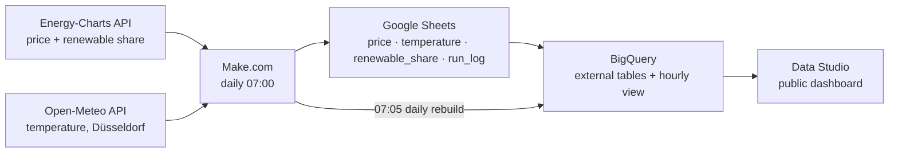

# When is heat cheap and green in Germany?

**A data product prototype for heat-pump households on a dynamic electricity tariff.**

> This project quantifies the opportunity. Smart energy managers capture it.

📊 **Live dashboard:** [Data Studio report](https://datastudio.google.com/reporting/d492828f-0405-4b50-ba8b-cdd5af2278fb) (updated daily)


---

## The business question

A heat pump turns electricity into heat. 
How much heat it delivers per kWh of power (its **COP**) drops when it is cold outside. 
So that a household on a dynamic tariff does not buy cheap power, but cheap **heat**:

```
cost of heat (ct/kWh) = electricity price (ct/kWh) ÷ COP
```

The cheapest **power** hour is therefore not always the cheapest **heat** hour. This project measures, with one year of German market data, **when heat is cheapest and greenest**, and how much timing matters.

| Persona | A heat-pump household in Düsseldorf on a dynamic tariff |
|---|---|
| Problem | They don't know when heat (not power) is cheapest |
| Answer | The hours of the day when heat is cheapest and greenest, with the reason (price ÷ COP) |
| Out of scope | Load control and automation. Products like 1KOMMA5° Heartbeat AI do that |

## Core insight

**Timing matters a lot, mostly because of price. COP refines it.**

| Finding | Number |
|---|---|
| Heat at midday (12:00) vs the evening peak (18:00) | **~45 % cheaper** (1.8 vs 3.2 ct per kWh of heat) |
| Days where a warmer hour beats the cheapest power hour (COP effect) | **1 in 5** heating days, ~5 % saving on those days |
| Renewable share in the cheapest heating hours | **~70 %**: green and cheap line up |

## Key findings: 8 business questions

Every answer below comes from one SQL file in [`/sql`](sql). Data: 1 Oct 2025 to Oct 2026, hourly.

| # | Question | Answer |
|---|---|---|
| Q1 | How many negative-price hours per month? | **523 hours** in the year, almost all March to September, peak **April 2026 with 123 hours (17 %)**. None in November and December. |
| Q2 | Average price by hour, weekday vs weekend? | Weekdays are cheapest around **13:00 (~6 ct/kWh)** and priciest around **19:00 (~17 ct/kWh)**. Weekends are cheaper all day, midday around **2 ct/kWh**. |
| Q3 | Which 3-hour window is cheapest each day? | Usually starting at **12:00 or 13:00** (210 of 378 days, solar). In **winter (Nov to Feb)** it moves to the **night (01:00 to 03:00)**. |
| Q4 | How does renewable share relate to price? | From **~21 ct/kWh** at 10 to 20 % renewables to **~2 ct** at 100 %, and **below zero** above 120 %. Green hours are cheap hours. |
| Q5 | What does 1 kWh of heat cost each hour? | Shifting heat from the evening peak (18:00) to midday (12:00) makes it **~45 % cheaper** (3.2 → 1.8 ct). |
| Q6 | How often do the cheapest heat and power hours differ? | On **58 of 295 heating days (~20 %)**. Picking the heat-optimal hour then saves **~0.10 ct per kWh of heat** (~5 %). Price drives timing, COP is the tie-breaker. |
| Q7 | When does heating run on the most renewables? | Greenest at **11:00 to 13:00 (~70 %)**, dirtiest at **18:00 to 20:00 (~46 %)**. The greenest hours are also the cheapest heat hours. |
| Q8 | Which hours are both freezing and expensive? | Rare last winter: **~10 hours** (mild winter in Düsseldorf). But then heat costs **~6 ct/kWh, about 3× the average**: the worst case a smart system avoids by pre-heating earlier. |

## Architecture



| Step | Tool | What happens |
|---|---|---|
| 1. Fetch | Make.com | Every morning: yesterday's prices (15-min), renewable share (15-min) and hourly temperature, 3 API calls |
| 2. Store | Google Sheets | Rows appended in bulk (one write per source, not row by row, to stay within free credits) |
| 3. Model | BigQuery | External tables read the Sheet live. A view joins price, temperature, COP and renewable share per hour, in German local time |
| 4. Serve | BigQuery + Make.com | Make.com rebuilds 4 small dashboard tables daily. This also renews every object before the sandbox's 60-day expiry |
| 5. Show | Data Studio | 4 charts and 3 key numbers, cache refreshed hourly |

All tools run on **free tiers**.

## API reliability

| Measure | Detail |
|---|---|
| Status codes | Every call checks for HTTP 200. Errors seen during the build: Energy-Charts **503** (4 Oct 2026), Open-Meteo **503 "service overloaded"** (13 Oct 2026) |
| Retries | Each API call and the BigQuery rebuild retry automatically: 3 attempts, 15 minutes apart |
| Run log | Every successful run writes one line to `run_log`: time, status, rows added per source |
| Duplicates | The hourly view ignores duplicate rows, so a re-run can't distort results |
| Rate limits | Energy-Charts allows 2 requests per minute per endpoint, the pipeline makes one per endpoint per day |

## Assumptions and limitations

| Topic | Assumption | Why it matters |
|---|---|---|
| Prices | **Wholesale day-ahead prices** (bidding zone DE-LU), before grid fees, taxes and margin | Only households on a dynamic tariff see these hourly swings. The **pattern** holds, the absolute ct/kWh don't |
| Heat pump | **Air-source** heat pump with **radiators** | Radiators need warmer water than floor heating, so lower COP. A conservative case |
| COP | When2Heat curves (Ruhnau et al. 2019): COP = 6.08 − 0.09·ΔT + 0.0005·ΔT², radiator heating curve 40 °C − 1.0 × outdoor temperature | Manufacturer-based, so real units run somewhat lower. Shifts all hours equally, so the **ranking** of hours holds |
| Heating hours | Hours below **15 °C** count as heating hours | Common German heating limit |
| Temperature | **One location: Düsseldorf** | Price is national, temperature is local |
| Period | 1 Oct 2025 onwards: history loaded once, then daily | One year, so seasonal patterns, no long-term trends |
| Infrastructure | BigQuery **sandbox** (no billing) | Data Studio can't read Sheet-backed tables directly for a personal account, so Make.com materialises the dashboard tables daily |

## Repository

```
sql/
├── 01_create_tables.sql        External tables on the Google Sheet
├── 02_cop_lookup.sql           COP per °C from the When2Heat curves
├── 03_hourly_heat_view.sql     One clean joined row per hour
├── 04_dashboard_tables.sql     Tables behind the 4 dashboard charts
├── 05_daily_refresh.sql        Everything Make.com runs daily
└── q1 … q8                     One file per business question, answer as a comment
```

`YOUR_SHEET_ID` is a placeholder: the Google Sheet itself is private.

## Possible next steps

These were deliberately left out to ship within the short time delivery scope:

- **Savings scenario:** one fixed household, evenly running vs shifting heat pump, euros per winter.
- **Seasonal gap:** midday vs evening heat cost per month, to show how the saving changes with the seasons.
- **Several locations:** temperature from more cities instead of Düsseldorf only.

## What I learned

- **Round only at the end.** Rounding prices to 2 decimals in the base view silently hid ~150 barely negative hours. The view now keeps full precision, only final answers are rounded.
- **Time zones are part of the data.** The APIs deliver UTC. "Hour of day" only makes sense in German local time, including the clock changes in March and October.
- **Check what the dashboard tool can actually read.** Data Studio can't query BigQuery tables backed by a Google Sheet from a personal account, so the pipeline stores small dashboard tables inside BigQuery instead.
- **Free tiers come with expiry dates.** The BigQuery sandbox deletes objects after 60 days, so the daily run re-creates everything and the dashboard keeps working.

## Data sources and licenses

| Source | Data | License |
|---|---|---|
| Bundesnetzagentur, SMARD.de, via [Energy-Charts](https://api.energy-charts.info/) (Fraunhofer ISE) | Day-ahead prices DE-LU, public power generation | CC BY 4.0 |
| [Open-Meteo](https://open-meteo.com/) | Hourly temperature, Düsseldorf | CC BY 4.0 |
| [When2Heat](https://data.open-power-system-data.org/when2heat/) (Ruhnau, Hirth, Praktiknjo, 2019) | Heat pump COP curves | CC BY 4.0 |
